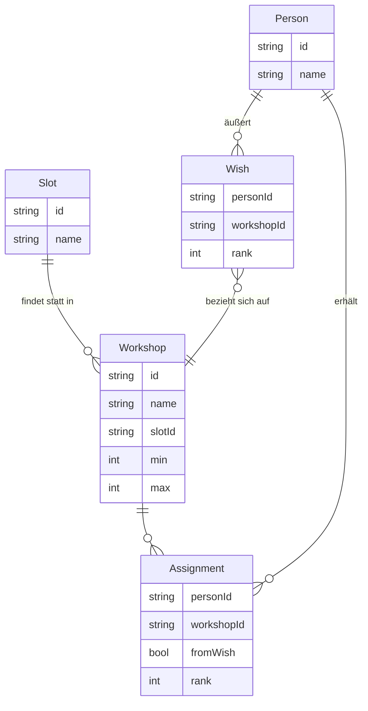

# Project Plan: Workshop-Planner

**Status:** draft
**Created:** 2026-10-09

## 1. Summary & Goals

Eine statische Webanwendung, mit der Veranstalter Workshop-Belegungen aus Teilnehmerwünschen berechnen: Jede Person wählt m Wünsche in Rangfolge, bekommt n Workshops zugewiesen; jeder Workshop hat Min- und Höchstbelegung und läuft in einem von mehreren Zeit-Slots. Alle Daten bleiben im Browser (kein Upload, kein Backend) — Datenschutz per Design.

**Ziele:**

1. Belegung wird vollständig client-seitig berechnet; es verlässt sich kein Datensatz den Browser.
2. Von CSV/XLSX-Import bis zur exportierbaren Zuteilung in unter 5 Minuten, ohne Doku lesen zu müssen.
3. Lösung ist nachweislich optimal bezüglich definierter Rangstrafen (LP/MIP im Browser) bzw. meldet Unlösbarkeit mit konkreter Ursache.
4. Für bis zu ~1.000 Personen × ~50 Workshops × ~10 Slots in < 10 Sekunden lösbar.

**Nutzer:** Veranstalter/Lehrkräfte, Anwendung 1–5× pro Veranstaltung (Szenario "einmal konfigurieren, einmal lösen").

## 2. Scope & Non-Goals

**MVP (dieser Plan):**

- Workshops anlegen (Name, min/max, Slot) + Slots verwalten
- Teilnehmerwünsche: CSV/XLSX-Import **plus** Inline-Korrektur/manuelles Eintragen im UI
- Solver (client-seitig) mit min/max-Belegung, n Workshops pro Person, 1 Workshop pro Slot
- Ergebnis-Ansicht: pro Workshop, pro Person, Belegungsstatistik, Warnungen
- Export (CSV) und Speichern/Laden des Projekts als JSON-Datei (lokal)

**Later / vision:**

- Teilnehmer geben Wünsche selbst über geteilten Link ein (ohne Server nur eingeschränkt möglich)
- „Was wäre wenn"-Szenarien, Solver-Feintuning über UI-Regler
- Mehrsprachigkeit

**Explicit non-goals:**

- Kein Backend, keine Accounts, keine Datenbank — nichts, was personenbezogene Daten auf Server speichert
- Keine Live-Kollaboration / kein gleichzeitiges Bearbeiten

## 3. Architecture Decisions

| #   | Decision     | Choice                                                  | Rationale                                                                                                        |
| --- | ------------ | ------------------------------------------------------- | ---------------------------------------------------------------------------------------------------------------- |
| A1  | Interface    | SPA, statisch gehostet (GitHub Pages)                   | Kein Server nötig; erfüllt „keine Datenuploads" strikt                                                           |
| A2  | Framework    | Svelte 5 + Vite                                         | Nutzervorgabe; kleinere Bundles als React, ideal für statische Apps                                              |
| A3  | UI-Style     | Bootstrap 5 (via sass)                                  | Nutzervorgabe; modernes, konsistentes Layout ohne Design-Aufwand                                                 |
| A4  | Solver       | `javascript-lp-solver` (Binär-LP) _(default)_           | Reines JS, klein, einfach; MIP reicht für Problemgröße. Fallback: `highs-js` (WASM) falls zu langsam             |
| A5  | Datenhaltung | Im-Speicher + localStorage-Autosave + JSON-Datei-Export | Ohne Backend sind Datei + localStorage die einzig datenschutzfreundlichen Optionen                               |
| A6  | Import       | `papaparse` (CSV) + `sheetjs` (XLSX) _(default)_        | Robuste, etablierte Parser; XLSX explizit gewünscht                                                              |
| A7  | Testing      | Vitest (Solver-Logik pur testbar)                       | Solver ist kritisch und frei von UI-Abhängigkeiten — ideal unit-testbar                                          |
| A8  | Deployment   | Codeberg Pages via Forgejo Actions                      | EU-basiert & gemeinnützig (datenschutzfreundlich); `tea` als CLI-Pendant zu `gh`; Build via CI in `pages`-Branch |

## 4. Tech Stack

- **Language / Runtime:** TypeScript, ES2022
- **Framework:** Svelte 5 + Vite
- **UI:** Bootstrap 5 (Sass-Integration), Bootstrap-Icons
- **Solver:** javascript-lp-solver (Binär-LP/Branch&Bound)
- **Import/Export:** papaparse, sheetjs (xlsx), Blob-Download für CSV/JSON
- **Tooling:** ESLint + Prettier, Vitest, Forgejo Actions (build + deploy auf Codeberg)
- **CLI:** `tea` (Gitea/Forgejo-CLI) für Repo-/Issue-/PR-Verwaltung

## 5. Data Model (initial)



Projekt-Container (`Project`): `{ slots[], workshops[], persons[], config { n, penaltyProfile }, meta }` — serialisierbar als JSON, Version-Feld für spätere Migration.

## 6. Interfaces & Contracts

**UI-Seiten (SPA-Routen / Tabs):**

1. **Slots & Workshops** — CRUD-Tabelle, Slot-Verwaltung, min/max-Spinner
2. **Teilnehmer & Wünsche** — Import-Dialog (CSV/XLSX, Spalten-Mapping-Dialog), Inline-Edit, Validierung
3. **Konfiguration** — n Workshops/Person, Straf-Profil („Fair" vs. „Effizient"), Solver-Laufzeit-Limit
4. **Ergebnis** — Kachel-Ansicht pro Slot/Workshop, Personenliste, „kein Wunsch"-Zuweisungen rot markiert, Statistiken (Ø Wunschrank, Verteilung), CSV-Export
5. **Projekt** — Speichern/Laden (JSON-Datei), Zurücksetzen

**Solver-Contract (reine Funktion, unabhängig testbar):**

```ts
solve(input: SolveInput): SolveResult
// SolveInput  = { persons, workshops, slots, config }
// SolveResult =
//  | { status: "optimal"|"feasible", assignments, stats }
//  | { status: "infeasible", reasons: string[] }   // z.B. "Slot A: min-Summe 24 > 12 Personen"
```

## 7. Phased Milestones

**Phase 1 — Skeleton:** Vite+Svelte+Bootstrap-Setup, Codeberg Pages Deploy läuft (Forgejo-Actions-Pipeline: `vite build` → `dist/` in `pages`-Branch), Slots/Workshops CRUD funktional, JSON-Save/Load. _Done by:_ leere App ist öffentlich erreichbar unter `<user>.codeberg.page`, Workshops anlegbar.

**Phase 2 — Core:** Personen-Import (CSV/XLSX + Mapping + Inline-Edit), Solver-Contract implementiert (LP mit min/max, n pro Person, 1 pro Slot), Ergebnis-Ansicht + CSV-Export. _Done by:_ kompletter Ablauf Import → Lösen → Export funktioniert.

**Phase 3 — Hardening:** Unlösbarkeits-Diagnosen (welche min/max kollidieren), Validierungen, Unit-Tests für Solver (kleine handgerechnete Fälle + Unlösbar-Fälle), localStorage-Autosave, Performance-Test mit 1.000 Personen. _Done by:_ Alle DoD-Kriterien erfüllt.

## 8. Risks & Mitigations

| Risk                                                                   | Impact             | Mitigation                                                                                                                                        |
| ---------------------------------------------------------------------- | ------------------ | ------------------------------------------------------------------------------------------------------------------------------------------------- |
| javascript-lp-solver zu langsam bei großen Instanzen                   | Berechnung > 30 s  | Solver hinter Interface abstrahieren; Wechsel auf highs-js (WASM) nur Drop-in                                                                     |
| Unlösbare Konstellationen frustrieren Nutzer                           | App wirkt „kaputt" | Explizite Unlösbarkeits-Analyse mit benannten Ursachen (z.B. „Kochen: min 6, aber nur 4 verfügbar") + konfigurierbare Aufweichung (min→empfohlen) |
| XSS/schadhafte Importdateien                                           | UI-Bruch           | Import nur als Daten parsen, niemals als HTML rendern; papaparse im Worker                                                                        |
| XLSX-Lizenzänderung (SheetJS)                                          | Build bricht       | Alternative: ExcelJS; Parser hinter Interface kapseln                                                                                             |
| Codeberg-Pages-Pipeline unreif / `tea`-Workflow kleinteiliger als `gh` | Deploy-Reibung     | Pipeline einmalig als Vorlage dokumentieren; Fallback: identischer Build auch auf GitHub Pages/Cloudflare deploybar                               |

## 9. Open Questions

1. **Q:** Soll es neben „n Workshops total" auch Regeln wie „max. x Workshops pro Tag" geben? **Working default:** Nein — nur n gesamt + 1 pro Slot _(default)_
2. **Q:** Gewünschte Standard-Straffunktion für Ränge (linear vs. exponentiell)? **Working default:** Linear mit konfigurierbarem Profil im Konfigurations-Tab _(default)_
3. **Q:** Braucht es Barrierefreiheit (WCAG AA, z.B. für Schule/öffentlich)? **Working default:** Bootstrap-Standard + Tastaturbedienbarkeit, keine formale AA-Prüfung _(default)_

## 10. Definition of Done

- [ ] Alle Daten bleiben client-seitig; es existiert kein Netzwerk-Request mit Personendaten (außer Assets-Load)
- [ ] CSV **und** XLSX importierbar, mit Spalten-Mapping und Nachkorrektur im UI
- [ ] Solver berücksichtigt: n pro Person, min/max pro Workshop, 1 Workshop pro Slot
- [ ] Unlösbare Fälle erzeugen verständliche Fehlermeldungen mit Ursache
- [ ] Ergebnis als CSV exportierbar (Zeilen: Person × Workshop × Slot)
- [ ] Projekt als JSON speicherbar/ladbar; Autosave in localStorage
- [ ] Unit-Tests decken Solver-Kern (mindestens 6 Fälle inkl. Unlösbar) ab, CI grün
- [ ] Auf Codeberg Pages erreichbar (`<user>.codeberg.page`), Lighthouse ≥ 90 (Performance, Accessibility)
